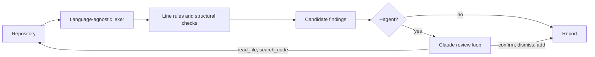

# SlopSweep

SlopSweep is a simple agent that reviews any codebase for four kinds of problems:

| Category | What it finds |
|---|---|
| **Security** | Leaked secrets, injection, unsafe deserialization, disabled TLS, weak crypto, XSS sinks, open CORS |
| **Slop** | Leftover AI chat text, truncated generated code, pasted Markdown fences, placeholder data, duplicated logic, comments that restate code |
| **Coding gaps** | Stub functions, unimplemented paths, swallowed errors, imports of files that do not exist, undocumented environment variables, missing tests |
| **Loose ends** | TODO and FIXME notes, merge conflicts, debugger statements, focused or skipped tests, commented-out code, unreachable code, leftover files |

It is **architecture agnostic**. It has no per-framework plugins and needs no build, so it works on monoliths, microservices, monorepos, scripts and infrastructure code alike. A small lexer separates code, strings and comments using only each language's comment and quote syntax, and files of unknown types still get secret and conflict checks.

## Quick start

Python 3.9 or newer is the only requirement for scanning.

```bash
git clone <this-repository>
cd slopsweep
python -m slopsweep examples/messy_app
```

Scan your own project and fail a CI job on serious issues:

```bash
python -m slopsweep /path/to/project --fail-on high
python -m slopsweep /path/to/project --format markdown --output report.md
```

See a [sample report](docs/sample-report.md) produced from the intentionally flawed demo.

## Agent mode

Pattern matching finds candidates quickly but cannot understand intent. With `--agent`, Claude investigates the scan results with read-only tools:

```bash
pip install "anthropic>=1.6"
export ANTHROPIC_API_KEY=...
python -m slopsweep /path/to/project --agent
```



The agent reads surrounding code, confirms real issues, dismisses false positives with a reason, and adds issues patterns cannot see, such as a missing authorization check. If the API is unavailable or the review stops early, the scanner report is still produced.

### Safety design

- **Read-only.** The agent has no tool that writes files or runs commands.
- **Secrets stay masked.** Recognized secrets are masked in reports and before text is sent to the API. Files such as `.env` and `*.pem` are withheld from the agent entirely.
- **Repository text is untrusted.** The prompt treats it as data, so instructions planted in comments are not followed.
- **Added findings need evidence.** The quoted text must exist within two lines of the cited location, or the finding is rejected.
- **Bounded.** `--max-steps` caps the review, and paths are limited to files in the scan.

## Options

| Option | Purpose |
|---|---|
| `--format text\|json\|markdown\|sarif` | Output format. SARIF works with GitHub code scanning |
| `--output FILE` | Write the report to a file |
| `--category NAME` | Limit to `security`, `slop`, `gap` or `loose-end` |
| `--min-severity LEVEL` | Hide findings below a severity |
| `--fail-on LEVEL` | Exit 1 when a finding reaches this severity |
| `--agent` | Add the Claude review |
| `--model`, `--effort`, `--max-steps` | Tune the review. The default model is `claude-opus-5-5` |
| `--show-dismissed` | Include findings the agent dismissed |
| `--list-rules` | Print every rule |

Silence a reviewed line with `slopsweep: ignore` or `slopsweep: ignore=SEC010` in a comment on that line or the line above. Paths in `.gitignore` and `.slopsweepignore` are skipped.

## Results

| Check | Result |
|---|---|
| Unit tests | 22 passing, using the standard library only |
| Flawed demo (`examples/messy_app`, 6 languages plus YAML) | Every planted issue class in the test suite detected |
| Safe look-alike code (`examples/clean_app`) | 0 findings |
| Large real codebase (the Anthropic Python SDK, 1,424 files) | About 24 seconds. Tuning against it cut findings from 1,873 to 172 |

## Limitations

- The scanner works on text patterns, so it does not trace data flow. Agent mode covers part of that gap.
- Findings are leads for review, and a clean report does not prove code is secure.
- The agent loop is tested against a simulated API client. A real run needs an Anthropic API key and is billed to that account.

## Development

```bash
python -m unittest discover -s tests
python -m slopsweep . --fail-on high
```

The project scans itself in CI. `examples/`, `tests/` and the rule definitions are excluded because they contain the patterns being detected on purpose.

## License

MIT
